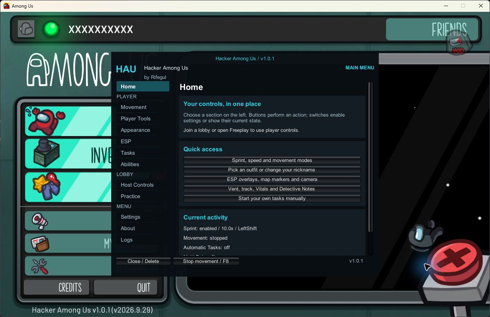
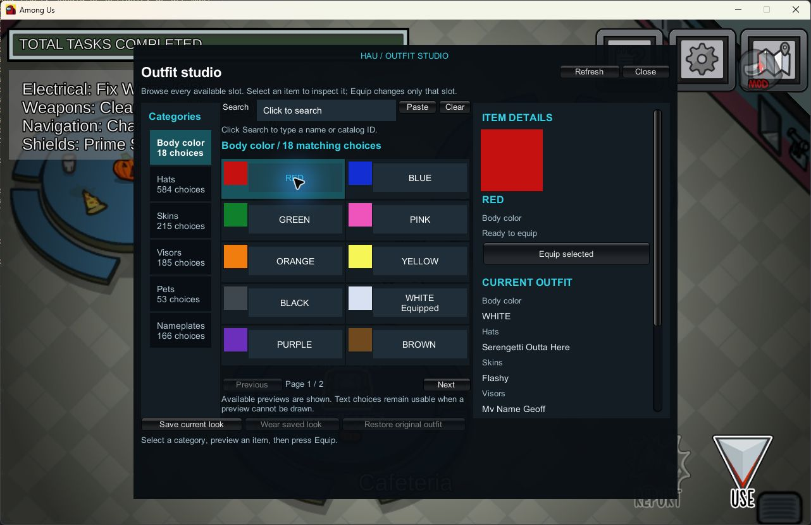

# Hacker Among Us (HAU)

**An Among Us mod by Rifegul. Version 1.0.1.**

A redesigned menu with clear categories, a new look and detailed controls.
For **Among Us 19.0.0 / 2026.9.29**, on **Windows 10/11, 64-bit**.

## Install

### Automatic installer / Steam, Microsoft Store and Xbox App

**[Download HAUSetup.exe](https://github.com/ProXgram/HackerAmongUs/releases/download/hau-v1.0.1/HAUSetup.exe)**

Close Among Us, open the file and click **Install**. It finds your game and
installs the mod and loader. If needed, click **Browse** and select `Among Us.exe`.

### Manual ZIP / all supported PC launchers

- **[Steam ZIP](https://github.com/ProXgram/HackerAmongUs/releases/download/hau-v1.0.1/HAU-1.0.1-Steam.zip)**
- **[Microsoft Store / Epic Games / Xbox App ZIP](https://github.com/ProXgram/HackerAmongUs/releases/download/hau-v1.0.1/HAU-1.0.1-MicrosoftStore-EpicGames-XboxApp.zip)**

Close Among Us, extract your ZIP and copy **everything inside it** directly
beside `Among Us.exe`. Open the game normally, wait for the first launch to
finish, then press **Delete**.

[Find your game folder and view the full instructions](docs/INSTALL.md).

## The new menu

| Section | What you can find |
| --- | --- |
| Home | Shortcuts, your current activity and whether you are host or guest. |
| Movement | Sprint up to **10×**, walking speed, follow, orbit, Lag Mode and teleport controls. |
| Player Tools | Meeting/report tools, door requests and chat settings. |
| Appearance | Outfit studio, random outfits, nickname editing, colors and visual effects. |
| ESP | Player labels, camera controls, map markers and direction lines. |
| Tasks | Manually enabled Automatic Tasks, AI Tasks and the task list. |
| Abilities | Multi Role, ability settings and clearly labeled local previews. |
| Host Controls | Hosted role assignment, Ghost Voting, shared round rules, meetings and player actions. |
| Practice | Freeplay role experiments. |
| Settings | Menu options, key choices, profiles and update settings. |
| About | Edition and game compatibility details. |
| Logs | Choose events to record and open or clear the event log. |

Each section groups related controls. **Buttons perform an action; switches
enable settings or show their current state.** Shared host actions stay disabled
for guests; Ghost Voting has a local opt-in.

## Outfit studio

The picker shows the game's loaded catalog. Cached images appear when their
layout supports previews; unavailable atlas previews show a placeholder.

Open **Appearance → Outfit & name → Open full outfit picker**. Browse colors,
hats, skins, visors, pets and nameplates. Search, inspect an item and equip just
that slot. Availability and what other players see depend on the game's checks.

## Tasks and movement

- **Sprint:** enable it in Movement and hold your chosen sprint key with the menu closed.
- **AI Tasks:** press Start AI Tasks under Tasks, then close the menu. It walks to your own task consoles.
- **Automatic Tasks:** turn it on yourself each round. It never starts from a saved profile.
- **F8:** stops movement automation and color cycling.

Multi Role combines vent access, tracking, Vitals and Detective tools in one
panel. Your assigned online role stays the same. Vent and other network requests
still depend on host validation.

**Ghost Voting needs the host and each voting ghost to enable the mod.**
Multiplayer vote counting remains untested.

## Automatic updates

Steam / Microsoft Store / Xbox App editions check for newer compatible releases
when Among Us starts. Updates install after you close the game, keeping your
settings. The switch is under **Settings → Automatic updates**.

If a game update breaks compatibility, a compatible mod release must be
published first. If the mod cannot start, run the latest installer. Epic Games
uses manual ZIP updates.

HAU 1.0.1 builds with official BepInEx Unity IL2CPP x64 build 788. Startup and
Freeplay have been checked on Xbox / Microsoft Store. Automated regression
checks cover the control, movement, task, outfit and update handlers. Steam,
Epic Games and multiplayer behavior remain untested for this release.

[Download page](https://github.com/ProXgram/HackerAmongUs/releases/tag/hau-v1.0.1) ·
[Source](https://github.com/ProXgram/HackerAmongUs/releases/download/hau-v1.0.1/HAU-1.0.1-Source.zip) ·
[GPL-3.0 license](LICENSE) · [Attribution](CREDITS.md)

This mod is not affiliated with or endorsed by Innersloth LLC. Among Us belongs
to Innersloth LLC.
